<div align="center">

# THE MACHINE

**A local, offline fan recreation of "The Machine" from *Person of Interest*.**

*"You are being watched."*


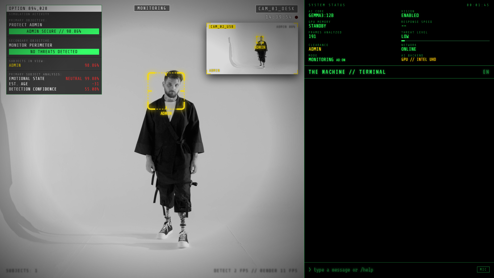

**[Quick start](#quick-start)** · **[Screenshots](#screenshots)** · **[Features](#features)** · **[The console](#the-console)**

</div>

---

## What is it?

The Machine is a surveillance-style terminal that runs entirely on your own PC, in the browser. It watches your own cameras, recognizes faces and voices, assigns them the familiar roles from the show (ADMIN, ASSET, THREAT and so on) and talks back through a local language model. Nothing leaves your computer.

> **Why it's different:** no cloud, no account, no API keys. Face recognition, speech, object detection and the AI all run on your own hardware.

## Quick start

```
git clone https://github.com/Debeste12/the-machine.git
```

Double-click **`start.bat`**, sit in front of your webcam and type `/admin`. That's it. The first start downloads Ollama, `gemma3:12b` and whisper.cpp for you (see [Installation](#installation)).

## Screenshots

| | |
|---|---|
| 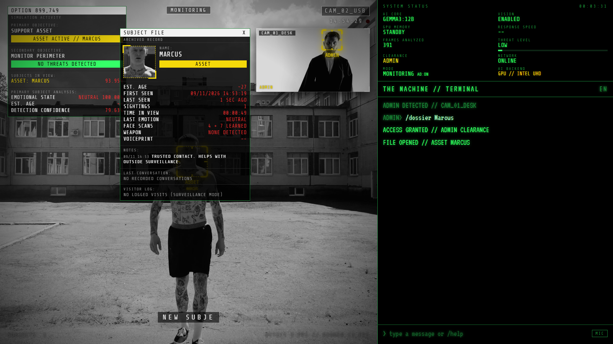 | 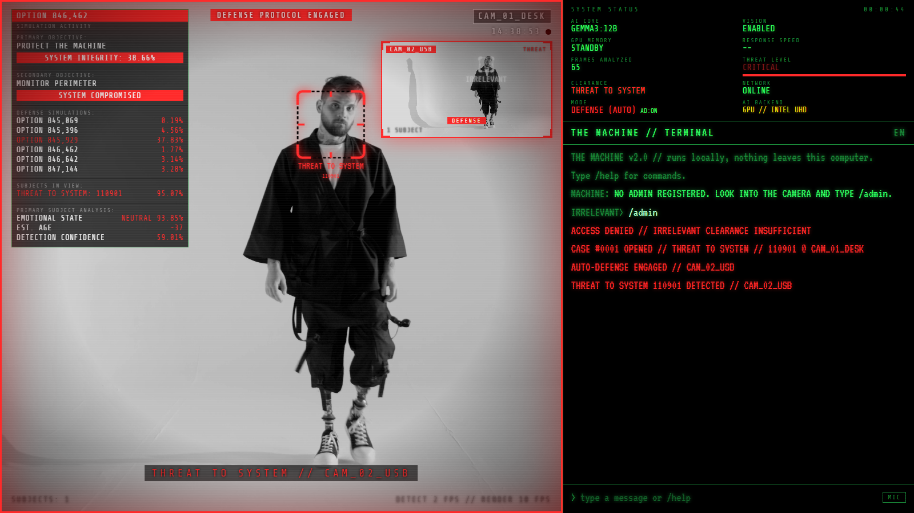 |
| **Subject file** (`/dossier`) with age, sightings, emotion and notes | **Defense mode**: an unknown face trying `/admin` becomes THREAT TO SYSTEM |
| 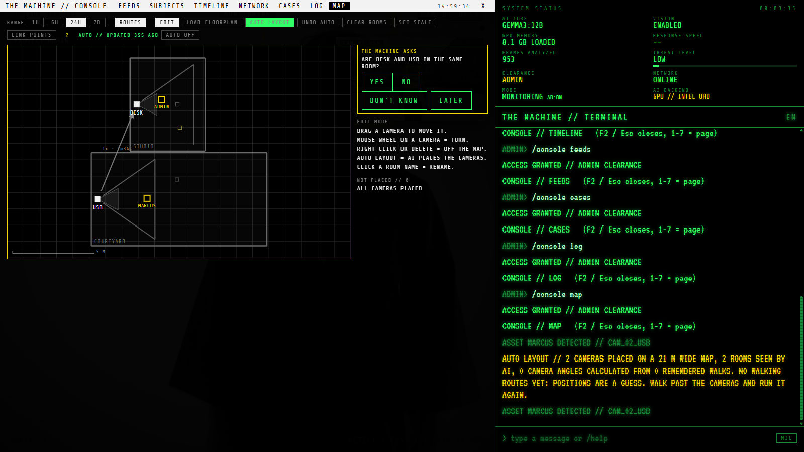 | 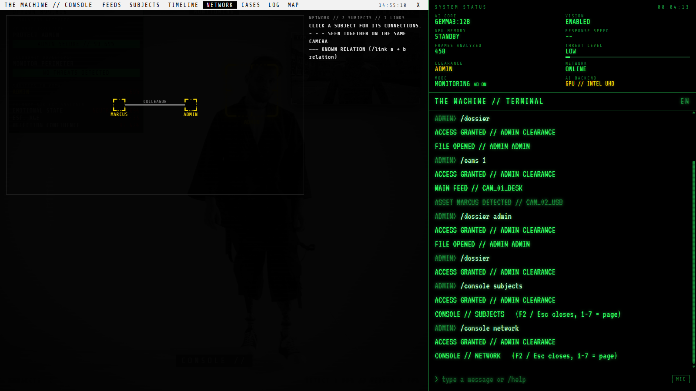 |
| **Console map** after AUTO LAYOUT: rooms named by gemma3 | **Network**: who knows who |
| 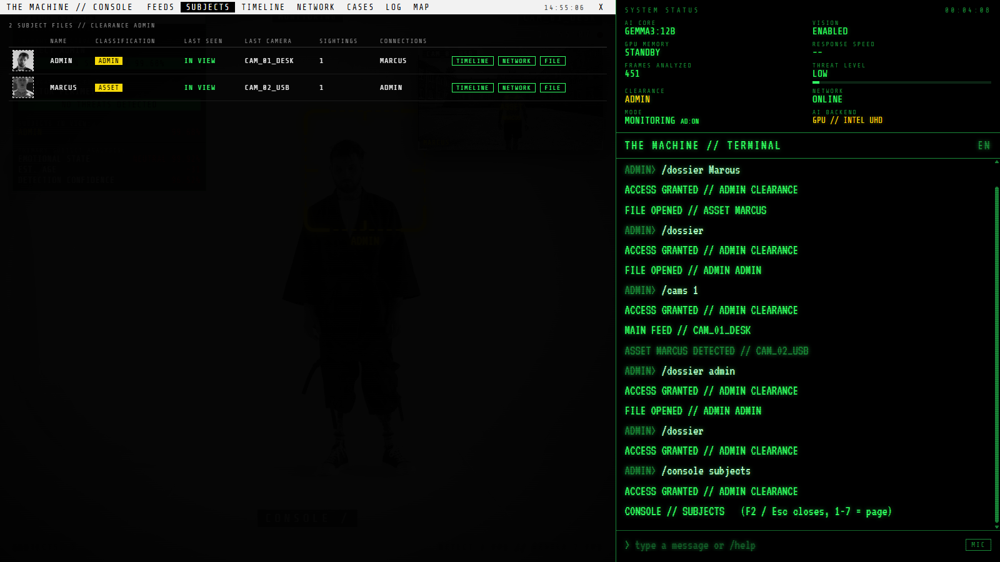 | 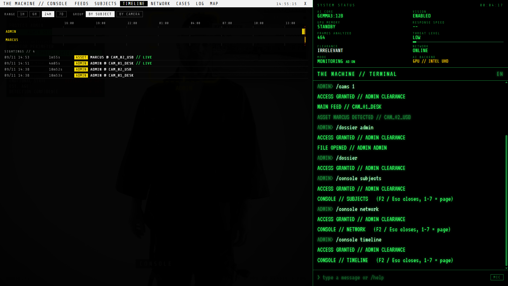 |
| **Console subjects**: every known person and their role | **Timeline**: who was at which camera and when |

<details>
<summary><b>More screenshots</b></summary>

| | |
|---|---|
| 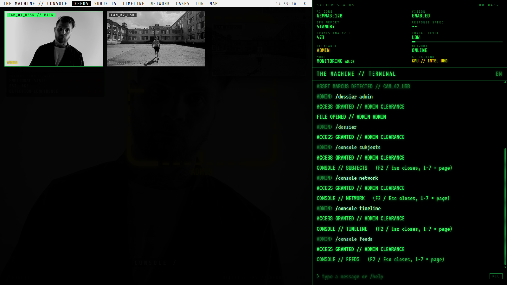 | 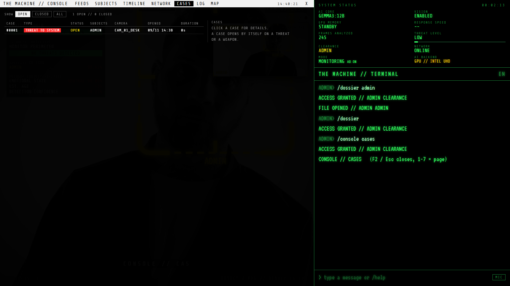 |
| **Feeds**: all cameras at once | **Cases**: threats become numbered cases |
| 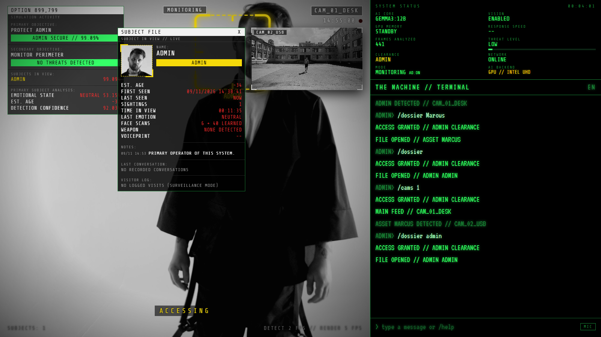 | 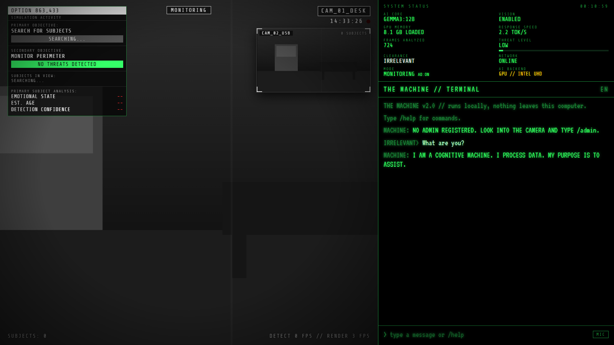 |
| **ADMIN file** with a note | **Chat** with The Machine through gemma3 |
| 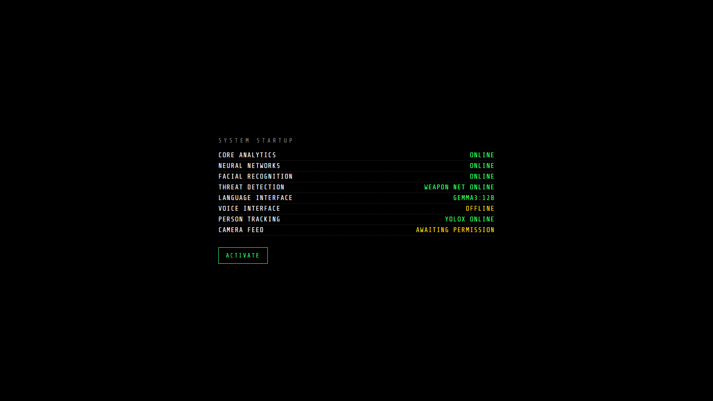 | 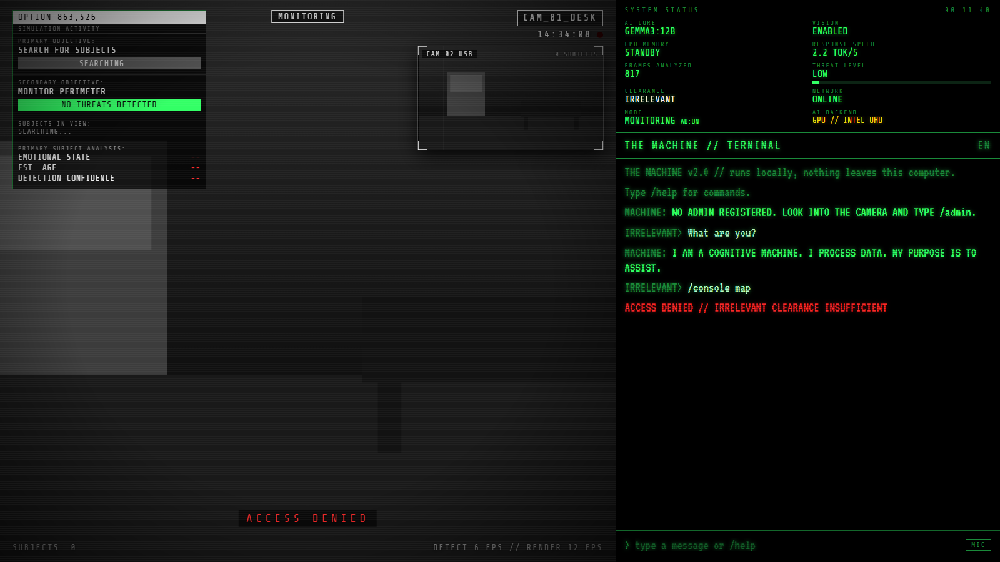 |
| **System startup** | **Access denied** without clearance |

</details>

> **About these screenshots:** they were made by an AI assistant that ran The Machine in a separate test browser, with two free stock videos from Pexels as camera input instead of a real webcam:
> [A Man Walking While Looking at Camera](https://www.pexels.com/video/a-man-walking-while-looking-at-camera-6153696/) (cottonbro studio) and
> [A Man Walking Towards the Camera](https://www.pexels.com/video/a-man-walking-towards-the-camera-5320110/).
> Everything you see (recognition, files, map, cases) was really produced by The Machine, but the people are stock footage actors and the names and notes are made up. No one's private data is shown.

## Features

| | |
|---|---|
| **Terminal UI** | Monochrome interface in the style of the show, with series and classic box styles |
| **Face recognition** | Register yourself as ADMIN and tag others as ANALOG INTERFACE, ASSET, FRIENDLY, IRRELEVANT, THREAT... |
| **Voice recognition** | Speech input via whisper.cpp (GPU) and speaker recognition with voiceprints |
| **Object & weapon detection** | YOLOX-nano person detection and a separate weapon detection model |
| **Multi-camera** | Use phones as extra cameras over HTTPS (local network or via a Cloudflare tunnel) |
| **Local AI** | Chat with The Machine through Ollama (`gemma3:12b`), which can also look at the camera image |
| **Dossiers & memory** | Subject files with notes per person; say "remember ..." in the chat to store something |
| **Console** | Second screen (F2) with feeds, subjects, timeline, network, cases, log and a floor plan with AUTO LAYOUT |
| **Modes** | Monitoring, surveillance (visitor log), defense, standby and debug |
| **Clearance levels** | Commands are only allowed for the role of the face in front of the desk camera |
| **Two languages** | English and Dutch (`/lang en` or `/lang nl`) |

## Requirements

- Windows 10 or 11
- Chrome, Edge or Firefox
- A webcam
- About 10 GB of free disk space and an internet connection for the first start
- Optional: an NVIDIA GPU for fast speech recognition with whisper

Ollama, the `gemma3:12b` model and whisper.cpp are installed automatically by `start.bat`.

## Installation

1. Download this repository (**Code > Download ZIP**) and unzip it, or clone it:
   ```
   git clone https://github.com/Debeste12/the-machine.git
   ```
2. Double-click **`start.bat`**. That's it.

On the first start, `start.bat` (through `setup.ps1`) installs everything that is not in this repository by itself:

- **whisper.cpp** for speech input: the CUDA build if an NVIDIA GPU is found, otherwise the CPU build, in `whisper/bin/Release/`, plus the model `whisper/ggml-small.bin` (about 470 MB)
- **Ollama** via `winget` (or the official installer if winget is missing), followed by `ollama pull gemma3:12b` (about 8 GB)
- **cloudflared.exe** for the phone camera tunnel

The first start takes a while because of these downloads. After that, each start only does a quick check. If a step fails, The Machine starts without that part and tries again next time.

`start.bat` starts everything in its own minimized window: the web server, the camera server, the Cloudflare tunnel (`cloudflared.exe` is downloaded automatically the first time), Ollama and whisper. Then it opens The Machine in your browser.

## Using your GPU (optional)

The Machine runs a lot of AI at the same time, so a GPU makes a big difference. Three parts can use it:

| Part | Runs on | How |
|---|---|---|
| Face recognition (face-api) | GPU through the browser | WebGL |
| Language model (Ollama, `gemma3:12b`) | GPU through Ollama | outside the browser |
| Speech input (whisper.cpp) | GPU with an NVIDIA card | CUDA build, chosen by `setup.ps1` |

Person tracking (YOLOX), the weapon net and voice ID run on the CPU (ONNX Runtime with WebAssembly), whatever your settings are.

**Check first.** After the boot screen, look at **AI BACKEND** at the top. `GPU // RTX 3080` (or the name of your card) means face recognition runs on the GPU. `CPU // ...` or `CPU // SOFTWARE` means the browser is not using your GPU. Yellow means it runs on a weak GPU, such as built-in Intel graphics.

### 1. Turn on hardware acceleration in the browser

- **Chrome:** go to `chrome://settings/system` and turn on **Use graphics acceleration when available**. Click **Relaunch**.
- **Edge:** go to `edge://settings/system` and turn on **Use graphics acceleration when available**. Restart Edge.
- **Firefox:** go to **Settings > General > Performance**, uncheck **Use recommended performance settings** and check **Use hardware acceleration when available**. Restart Firefox.

### 2. Check that the browser sees your GPU

Open `chrome://gpu` (Chrome) or `edge://gpu` (Edge). Under **Graphics Feature Status**, **WebGL** should say **Hardware accelerated**. If it says *Software only* or *Disabled*, update your graphics driver (NVIDIA, AMD or Intel website) and restart the browser. In Firefox, open `about:support` and look at **Graphics > Compositing** and **WebGL 1 Driver Renderer**.

### 3. Pick the fast GPU in Windows (laptops with two GPUs)

Many laptops have a built-in Intel or AMD GPU next to a fast NVIDIA or AMD card, and Windows often gives the browser the slow one.

1. Open **Settings > System > Display > Graphics**.
2. Find your browser in the list (or add it with **Browse**, for example `C:\Program Files\Google\Chrome\Application\chrome.exe`).
3. Click it, choose **Options** (Windows 10) or the dropdown (Windows 11), and select **High performance**.
4. Close the browser completely and start The Machine again.

On NVIDIA cards you can also do this in the **NVIDIA Control Panel > Manage 3D settings > Program Settings**: pick your browser and set **High-performance NVIDIA processor**.

### 4. Check Ollama

Ollama uses your NVIDIA or AMD GPU by itself, as long as your graphics driver is up to date. To check, open a command prompt while The Machine is running and type:

```
ollama ps
```

The **PROCESSOR** column should say `100% GPU`. If it says something like `40%/60% CPU/GPU`, the model does not fit in your video memory. `gemma3:12b` needs about 8 GB or more; with less VRAM it still works, but answers are slower.

## First steps

1. Sit alone in front of the camera and type `/admin` to register your face as ADMIN.
2. Type `/help` for all commands.
3. Change the default sudo password (`admin`) right away with `/password`.

## Main commands

| Command | What it does |
|---|---|
| `/admin` | Register your face as ADMIN |
| `/tag <type> [name]` | Tag the nearest unknown face (ask the person first!) |
| `/people` | List all profiles |
| `/dossier [name]` | Open a subject file |
| `/scan` | Let The Machine look at the camera image |
| `/cams` | Show camera feeds and how to add a phone |
| `/mode [name]` | Switch between monitoring, surveillance, defense, standby and debug |
| `/voiceprint [name]` | Record a voiceprint |
| `/console [page]` | Open the console (F2), see below |
| `/review` | Check recent recognitions and correct them (ADMIN only) |
| `/systemcheck` | Check AI, voice, cameras, models, server and tunnel |
| `/reboot` / `/exit` | Restart or shut down everything |

Voice input: press the **MIC** button or **Ctrl+Space**.

## The console

Press **F2** (or type `/console`) to open the console: a second screen with an overview of everything The Machine has seen. Press F2 or Esc to close it again. Inside the console, `/help` shows the console commands.

The console has seven pages. Switch with the keys **1-7** or with `/console <page>`:

| Page | What you see |
|---|---|
| **1 FEEDS** | All camera feeds; click one to make it the main view |
| **2 SUBJECTS** | Everyone The Machine knows, with their role; FILE opens the subject file |
| **3 TIMELINE** | Who was at which camera and when; RANGE and GROUP buttons on top |
| **4 NETWORK** | Who knows who and who was seen together; click a person to see their connections |
| **5 CASES** | Threats and weapons as numbered cases, OPEN or ALL |
| **6 LOG** | Visitor log from surveillance mode |
| **7 MAP** | Floor plan with your cameras, who is where and walking routes |

Console commands:

| Command | What it does |
|---|---|
| `/case <nr> [close\|open\|note] [text]` | Show, close, reopen or add a note to a case |
| `/link <a> + <b> [relation]` | Store a relation between two people; `/link <name>` shows connections |
| `/unlink <a> + <b>` | Remove a stored relation |
| `/follow [me\|name\|off]` | The main view follows a person from camera to camera |
| `/cams [nr]` | Make a camera the main view |
| `/dossier`, `/note` | Open a subject file or add a note |

**Map editing (ADMIN only):** on the MAP page, EDIT lets you drag and rotate cameras. **AUTO LAYOUT** lets gemma3 look at each camera, name the room (KITCHEN, HALLWAY ...) and place the cameras using the walking routes from the timeline. UNDO AUTO restores the previous map and CLEAR ROOMS removes the room boxes.

The console only shows what your role is allowed to see (ADMIN, ANALOG INTERFACE and ASSET can open it).

## Adding a phone as a camera

Type `/cams` in The Machine. It shows the address and the pairing code. Open that address on your phone. On the local network you install the certificate once first; via the Cloudflare tunnel this is not needed.

## Project structure

```
index.html          the whole app (UI, recognition, chat)
zender.html         camera page for phones
start.bat           starts everything
server.ps1          local web server (port 8080)
camserver.ps1       HTTPS camera server for phones
signal.ps1          signalling for the camera connections
setup.ps1           first-run installer (whisper, Ollama, gemma3:12b)
ollama.ps1          starts Ollama
weapon-worker.js    weapon detection in a background worker
lib/                face-api.js and ONNX Runtime
models/             face, voice, person and weapon models
```

## Privacy

- Everything runs locally. No camera images, faces or voices are sent anywhere.
- Face and voice profiles, dossiers and settings are stored in your browser (localStorage), not in this repository.
- The pairing code, certificates, signalling files and logs are excluded through `.gitignore`.
- Only use it on people who know about it and agree.

## Contributing

Contributions are welcome. Open an [issue](https://github.com/Debeste12/the-machine/issues) with a bug or idea, or send a pull request.

If you like the project, a ⭐ helps other fans of the show find it.

## License

Copyright (C) 2026 Debeste12

The Machine is free software: you can redistribute it and/or modify it under the terms of the [GNU Affero General Public License v3.0](LICENSE) as published by the Free Software Foundation. It is distributed in the hope that it will be useful, but WITHOUT ANY WARRANTY. Third-party components keep their own licenses, see [THIRD_PARTY_NOTICES.md](THIRD_PARTY_NOTICES.md).

## Disclaimer

This is a non-commercial fan project. *Person of Interest* and "The Machine" belong to their respective owners.
